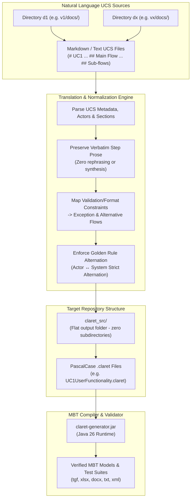

# ucs-to-claret — Natural Language UCS to CLARET Specification Translator

Translates Use Case Specifications (UCS) written in natural language (Markdown/Text) into formal, syntactically valid **CLARET** (`.claret`) specifications ready for Model-Based Testing (MBT) test suite generation.

---

## ⚙️ Workflow Architecture & Process Diagram



---

## 📋 Core Behavioral Guarantees & Constraints

1. **Verbatim Step Text Preservation**:
   - The exact sentences and lines of text written for each step in the natural language specification **must not be rephrased, shortened, or synthesized**.
   - Text is preserved verbatim inside quotes, only cleaning internal formatting artifacts, bracket tags (like `[S1]`, `[E1]`), and escaping double quotes (`"` &rarr; `'`).

2. **The Golden Rule (Strict Alternation)**:
   - Steps must strictly alternate between actor actions and system responses:
     ```claret
     step 1 <actorId> "<user action>" af[...]
     step 2 system "<system response>" ef[...]
     step 3 <actorId> "<user action>"
     step 4 system "<system response>"
     ```
   - Consecutive steps performed by the same party are prohibited.
   - `af` (Alternative Flows): Must always be initiated by an actor action and branch from an actor step in the basic flow (`af[n]`).
   - `ef` (Exception Flows): Must always be initiated by a system action and branch from a system step in the basic flow (`ef[n]`).
   - `bs` (Return Step in Alternative Flow): If an alternative flow ends with an actor action, it returns to a system step in basic flow (`bs 2` or `bs 4`). If it ends with a system step, it returns to an actor step.

3. **Handling Business Rules & Constraints**:
   - Rules specifying error conditions, format validation (e.g. Section Data Format), timeouts, or lockouts are mapped to **`exception` flows** (`ef[...]`).
   - Rules specifying alternate user choices (e.g. deleting instead of adding, choosing another mode) are mapped to **`alternative` flows** (`af[...]`).

4. **Flat Output Structure**:
   - All translated `.claret` files are saved directly in `claret_src/` without subdirectories.
   - Files are named in PascalCase with technical acronym preservation (e.g. `UC1UserFunctionality.claret`, `UC2AuthenticateUsers.claret`).

---

## 1. Native Agent-Driven Workflow (Recommended)

When an LLM agent executes this skill:

1. **Locate Natural Language UCS Files**:
   - Identify directories provided by user (e.g. `v1/docs`, `v2/docs`, etc.).
   - Scan for files matching `UC*.md`, `*usecase*`, or containing `# UC` headings.

2. **Execute Automated Translator**:
   ```bash
   python claret-version-control-system/.claude/skills/ucs-to-claret/scripts/ucs_to_claret.py \
     --dirs v1/docs \
     --output-dir claret_src \
     --system-name iTrust2 \
     --version 1.0
   ```

3. **Verify Generated `.claret` Files**:
   - Verify that all `.claret` files reside in `claret_src/` with zero subfolders.
   - Confirm that the validator compiled all specifications with `claret-generator.jar` without syntax errors.

---

## 2. Standalone CLI Invocation (Automated / Headless)

```bash
# Translate all UCS files from v1/docs into claret_src/ with automatic validation
python claret-version-control-system/.claude/skills/ucs-to-claret/scripts/ucs_to_claret.py \
  --dirs v1/docs \
  --output-dir claret_src \
  --system-name iTrust2

# Translate multiple version directories
python claret-version-control-system/.claude/skills/ucs-to-claret/scripts/ucs_to_claret.py \
  --dirs v1/docs v2/docs v3/docs \
  --output-dir claret_src \
  --clean
```

### Parameters

- `--dirs`: (Required) One or more directory paths or file paths containing natural language UCS files.
- `--output-dir`: (Optional) Output directory. Defaults to `claret_src`. Files are saved flatly without subdirectories.
- `--system-name`: (Optional) System identifier for `systemName` clause. Defaults to `iTrust2`.
- `--version`: (Optional) Version string for use case metadata (defaults to `1.0`).
- `--no-validate`: (Optional) Skip compilation verification via `claret-generator.jar`.
- `--clean`: (Optional) Clean target `output-dir` before generation.

---

## 3. Reference Mapping Example

### Input: Natural Language Markdown UCS (`v1/docs/UC1.md`)
```markdown
# UC1 User Functionality

## 1.1 Preconditions
The iTrust2 Admin has authenticated themselves in the iTrust2 Medical Records system [UC3](uc3).

## 1.2 Main Flow
The admin selects the option to create a user [S1] or delete a user [S2].  A success message is displayed and the action is logged.

## 1.3 Sub-flows
  * [S1]: An Admin enters a user name, a password, confirm password, the role, and if the user is enabled (or active) in the system. The Admin presses the button to add the user [E1][E2].
  * [S2]: An Admin selects a user from the list of possible users, confirms the delete, and presses the button to delete the user.

## 1.4 Alternative Flows
  * [E1] The system prompts the Admin to correct the format of a required data field.
  * [E2] The password and repeated password must match or an error is displayed.
```

### Output: Formal CLARET Specification (`claret_src/UC1UserFunctionality.claret`)
```claret
systemName "iTrust2"
usecase "UC1 User Functionality" {
  version "1.0" type "Creation" user "Admin" date "30/10/2026"
  actor admin "Admin"
  preCondition "The iTrust2 Admin has authenticated themselves in the iTrust2 Medical Records system UC3."
  basic {
    step 1 admin "An Admin enters a user name, a password, confirm password, the role, and if the user is enabled (or active) in the system. The Admin presses the button to add the user." af[1]
    step 2 system "displays a success message and logs transaction" ef[1, 2]
  }
  alternative 1 "Delete user" {
    step 1 admin "An Admin selects a user from the list of possible users, confirms the delete, and presses the button to delete the user." bs 2
  }
  exception 1 "Invalid data field format" {
    step 1 system "prompts the Admin to correct the format of a required data field."
  }
  exception 2 "Password mismatch" {
    step 1 system "alerts that the password and repeated password must match or an error is displayed."
  }
  postCondition "A success message is displayed and the action is logged."
}
```

