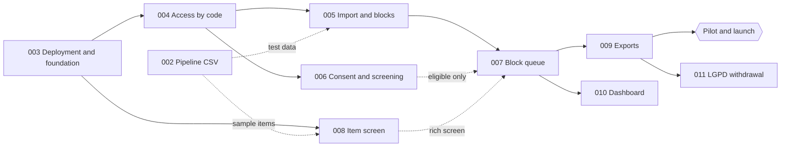

# Veredito implementation roadmap

Spec [001-oracle-labeling](./001-oracle-labeling/spec.md) is the overview and the source of the rules. Specs 002 to 011 split it into slices that can be planned (`/speckit-plan`), broken into tasks (`/speckit-tasks`) and implemented one at a time, each one testable and deployable on its own.

Terms and identifiers (English everywhere in the repository; UI in pt-BR, en-US and es-ES; data kept in its capture language) are defined in [GLOSSARY.md](./GLOSSARY.md).

**Environments**: **production** is Google Cloud (project `veredito-issta2027`); **staging** (tests) is **local, in Docker** (`docker compose --profile staging up --build`). There is no cloud staging. Details in [research.md](./001-oracle-labeling/research.md#local-staging-docker).

## Order

| Order | Spec | Delivers | Depends on |
|---|---|---|---|
| 1 | [002-oracle-import-csv](./002-oracle-import-csv/spec.md) | Import CSV generated by the pipeline | - |
| 2 | [003-deployment-foundation](./003-deployment-foundation/spec.md) | App online (Google Cloud), database, local staging in Docker, rule tests, i18n infrastructure (pt-BR, en-US, es-ES) | - |
| 3 | [004-email-code-access](./004-email-code-access/spec.md) | Language choice; sign-in by code; separate administrator | 003 |
| 4 | [005-block-import](./005-block-import/spec.md) | Import, preview, blocks and queue | 004 |
| 5 | [007-block-queue](./007-block-queue/spec.md) | Request, answer, review and submit blocks; concurrency | 004, 005 |
| 6 | [006-consent-screening](./006-consent-screening/spec.md) | Consent form, skill, screening | 004 |
| 7 | [008-item-screen](./008-item-screen/spec.md) | Differences, use-case modals, explained questions | 003 (sample items from 002) |
| 8 | [009-exports](./009-exports/spec.md) | Wide and long tables; pipeline files | 005, 007 |
| - | **Pilot and launch** | see below | 002 to 009 |
| 9 | [010-progress-dashboard](./010-progress-dashboard/spec.md) | Data collection dashboard | 005, 006, 007 |
| 10 | [011-lgpd-withdrawal](./011-lgpd-withdrawal/spec.md) | Anonymization and disposal | 007, 009 |

Specs are implemented one at a time, in this order (constitution, *Restrictions and workflow*). 007 comes before 006 and 008 to tackle the biggest risk early, the concurrency in block reservation. Until 006 exists, every participant with a session is treated as eligible (spec 007, *Assumptions*); 007 uses a simple item screen and replaces it with the one from 008 when that is ready, without changing what is stored.

Solid arrows are hard dependencies; dashed ones are integrations that do not block the start of the work.

## Why this order

- **002 and then 003.** They depend on nothing. 002 comes first because it is small and fixes the contract between the pipeline and Veredito: it produces a real file (long texts, quotes, line breaks), which is the item data for local staging and serves as a test for 005 and 008. 003 fixes the data structure, the deployment on Google Cloud and local staging in Docker, which avoids redoing tables in the following specs. It also sets up the i18n infrastructure (`@angular/localize` with one build per locale served under `/pt-BR/`, `/en-US/` and `/es-ES/`, Spring MessageSource, and the CI completeness checks), so every later spec adds its strings in the three locales from the start.
- **004 alone.** Every screen, for participants and for the administrator, depends on knowing who the person is. It is the only real bottleneck; that is why it comes early and isolated. It also brings the language-choice screen shown before sign-in and the `preferred_language` of the participant profile.
- **005 and right after it 007.** The import only needs the administrator and creates the blocks. 007 is the riskiest part (concurrency and reservation); the rule for choosing the next block is a function tested in isolation since 003, so the risk is tackled before the rich screen exists. The simple screen avoids waiting for 008.
- **006 and then 008.** The consent form and the screening only need the participant and complete the eligibility that 007 left open; the item screen only needs sample items and replaces the simple screen of 007.
- **009 before the launch.** Without export, the collected data does not reach the pipeline. It uses test responses generated in local staging.
- **010 and 011 after the launch.** The study works without them. 010 can be brought forward if the researcher wants to follow the pilot on the dashboard; 011 must be ready before the first withdrawal request.

## Milestones

1. **Foundation online** (002 and 003): fixed URL on Google Cloud, database prepared, local staging starting with one command, Minitest CSV generated, UI built in pt-BR, en-US and es-ES.
2. **Access** (004): anyone chooses the language and signs in; the administrator sees their own area.
3. **Ready for data labeling** (005, 007, 006 and 008): complete volunteer flow.
4. **Pilot** (009 ready):
   - in local staging, run the test with 30 simultaneous participants (spec 007, SC-001, automated test) and a complete flow with a reduced reservation time;
   - deploy to production (phase `pilot`, which only accepts Minitest), import Minitest and invite 3 to 5 colleagues, warning them that the pilot responses will be discarded;
   - measure the time per block (spec 008, SC-002) and the Cloud Run cold start, and listen to the colleagues about the clarity of the questions;
   - export and run `agreement` and `oracle-disagreements` on the files (spec 009, SC-001);
   - fix and rehearse locally; **recreate the production database empty** (drop and create again the `veredito` database in Cloud SQL) and deploy, so that Flyway prepares it from scratch;
   - switch the study phase to `collection` (spec 005), publish the final consent form, import the real dataset and announce.
5. **Monitored data collection** (010) and **complete LGPD** (011).

## Coverage of spec 001

| Requirements of 001 | Spec |
|---|---|
| Appendix D (generate the CSV) | 002 |
| Deployment, database, local staging, rule tests, i18n infrastructure | 003 |
| FR-001 to FR-005, FR-050 (User Stories 1 and 6); language-choice screen | 004 |
| FR-011, FR-012, FR-051 to FR-055 (User Story 7) | 005 |
| FR-006 to FR-010 (User Story 2) | 006 |
| FR-013, FR-020 to FR-027, FR-034, FR-040 to FR-042 (User Stories 3 and 5) | 007 |
| FR-030 to FR-033 (User Story 4) | 008 |
| FR-057, FR-058, FR-060 (User Story 8) | 009 |
| FR-056 (User Story 9) | 010 |
| FR-059 (User Story 10) | 011 |

## How to use with Spec Kit

For each spec, in the order above:

1. Point `.specify/feature.json` to the spec folder (for example, `{"feature_directory":"specs/003-deployment-foundation"}`).
2. Run `/speckit-plan`, then `/speckit-tasks` and `/speckit-implement`. In each Veredito spec (003 to 011), the `contracts/` of the plan lists the resources (under `/api/v1`), the HTTP methods and status codes, the link relations and the actions per state (Richardson level 3), and each new operation is documented in Swagger.
3. Run in local staging (Docker), check the success criteria of the spec, deploy to production and only then move on to the next one.

The plans follow the [constitution](../.specify/memory/constitution.md) (version 2.7.0: Angular with Angular Material, Spring Boot with a level 3 REST API versioned in the path (`/api/v1`), documented in Swagger and tested with REST Assured, MySQL with Flyway; production on Google Cloud, local staging in Docker; staging, tests and pilot only with Minitest items; English everywhere in the repository, internationalized UI (pt-BR, en-US, es-ES) and data kept in its capture language) and the technology selection in [research.md](./001-oracle-labeling/research.md). The code lives in the orphan branch `Veredito` of `diegoquirino/openscience`.
