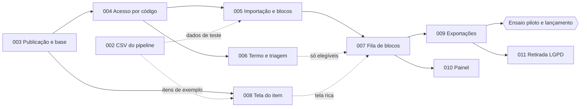

# Roteiro de implementação do Veredito

A spec [001-rotulagem-oraculo](./001-rotulagem-oraculo/spec.md) é a visão geral e a fonte das regras. As specs 002 a 011 a dividem em fatias que podem ser planejadas (`/speckit-plan`), quebradas em tarefas (`/speckit-tasks`) e implementadas uma de cada vez, cada uma testável e publicável sozinha.

**Ambientes**: a **produção** é o Google Cloud (projeto `veredito-issta2027`); o **ensaio** (testes) é **local, em Docker** (`docker compose --profile ensaio up --build`). Não há ensaio na nuvem. Detalhes em [research.md](./001-rotulagem-oraculo/research.md#ensaio-local-docker).

## Ordem

| Ordem | Spec | Entrega | Depende de | Pode correr junto com |
|---|---|---|---|---|
| 1 | [002-csv-oraculo](./002-csv-oraculo/spec.md) | CSV de importação gerado pelo pipeline | — | 003 |
| 1 | [003-publicacao-base](./003-publicacao-base/spec.md) | App no ar (Google Cloud), base de dados, ensaio local em Docker, testes das regras | — | 002 |
| 2 | [004-acesso-codigo-email](./004-acesso-codigo-email/spec.md) | Login por código; administrador separado | 003 | — |
| 3 | [005-importacao-blocos](./005-importacao-blocos/spec.md) | Importação, prévia, blocos e fila | 004 | 006, 008 |
| 3 | [006-consentimento-triagem](./006-consentimento-triagem/spec.md) | Termo, habilidade, triagem | 004 | 005, 008 |
| 3 | [008-tela-item](./008-tela-item/spec.md) | Diferenças, modais do caso de uso, perguntas explicadas | 003 (itens de exemplo da 002) | 005, 006 |
| 4 | [007-fila-blocos](./007-fila-blocos/spec.md) | Pedir, responder, revisar e enviar blocos; concorrência | 004, 005 | — |
| 5 | [009-exportacoes](./009-exportacoes/spec.md) | Tabelas larga e longa; arquivos do pipeline | 005, 007 | 010 |
| — | **Ensaio piloto e lançamento** | ver abaixo | 002 a 009 | — |
| 6 | [010-painel-andamento](./010-painel-andamento/spec.md) | Painel da coleta | 005, 006, 007 | 009, 011 |
| 7 | [011-retirada-lgpd](./011-retirada-lgpd/spec.md) | Anonimização e descarte | 007, 009 | 010 |

A spec 008 tem número maior que a 007, mas pode ser feita antes dela, junto com a 005 e a 006. A 007 usa uma tela de item simples e troca pela da 008 quando esta estiver pronta, sem mudar o que é gravado.

Setas cheias são dependências duras; tracejadas, integrações que não bloqueiam o início do trabalho.

## Por que esta ordem

- **002 e 003 primeiro, em paralelo.** Não dependem de nada. A 002 fixa o contrato entre o pipeline e o Veredito e produz um arquivo real (textos longos, aspas, quebras de linha), que serve de teste para a 005 e a 008. A 003 fixa a estrutura de dados, a publicação no Google Cloud e o ensaio local em Docker, o que permite tocar as specs seguintes em paralelo sem refazer tabelas.
- **004 sozinha.** Todas as telas, de participante e de administrador, dependem de saber quem é a pessoa. É o único gargalo real; por isso vem cedo e isolada.
- **005, 006 e 008 em paralelo.** A importação só precisa do administrador; o termo e a triagem só precisam do participante; a tela do item só precisa de itens de exemplo.
- **007 assim que houver blocos.** É a parte de maior risco (concorrência e reserva). A regra de escolha do próximo bloco é uma função testada isoladamente desde a 003, então o risco é atacado antes de a tela existir. A tela simples evita esperar pela 008.
- **009 antes do lançamento.** Sem exportação, os dados coletados não chegam ao pipeline. Pode começar logo depois da 005, com respostas de teste.
- **010 e 011 depois do lançamento.** O estudo funciona sem elas. A 010 pode ser antecipada se o pesquisador quiser acompanhar o piloto pelo painel; a 011 precisa estar pronta antes do primeiro pedido de retirada.

## Marcos

1. **Base no ar** (002 e 003): URL fixa no Google Cloud, base preparada, ensaio local subindo com um comando, CSV do Minitest gerado.
2. **Acesso** (004): qualquer pessoa entra; o administrador vê a área dele.
3. **Pronto para classificar** (005, 006, 007 e 008): fluxo completo do participante.
4. **Ensaio piloto** (009 pronta):
   - no ensaio local, rodar o teste de 30 participantes simultâneos (spec 007, SC-001, teste automático) e um fluxo completo com o tempo de reserva reduzido;
   - publicar em produção (fase `piloto`, que só aceita o Minitest), importar o Minitest e convidar de 3 a 5 colegas, avisando que as respostas do piloto serão descartadas;
   - medir o tempo por bloco (spec 008, SC-002), a partida a frio do Cloud Run e ouvir os colegas sobre a clareza das perguntas;
   - exportar e rodar `agreement` e `oracle-disagreements` sobre os arquivos (spec 009, SC-001);
   - corrigir e ensaiar localmente; **recriar vazio o banco de produção** (apagar e criar de novo o banco `veredito` no Cloud SQL) e publicar, para o Flyway prepará-lo do zero;
   - passar a fase para `coleta` (spec 005), publicar o termo definitivo, importar a base real e divulgar.
5. **Coleta acompanhada** (010) e **LGPD completa** (011).

## Cobertura da spec 001

| Requisitos da 001 | Spec |
|---|---|
| Apêndice D (gerar o CSV) | 002 |
| Publicação, base, ensaio local, testes das regras | 003 |
| FR-001 a FR-005, FR-050 (User Stories 1 e 6) | 004 |
| FR-011, FR-012, FR-051 a FR-055 (User Story 7) | 005 |
| FR-006 a FR-010 (User Story 2) | 006 |
| FR-013, FR-020 a FR-027, FR-034, FR-040 a FR-042 (User Stories 3 e 5) | 007 |
| FR-030 a FR-033 (User Story 4) | 008 |
| FR-057, FR-058, FR-060 (User Story 8) | 009 |
| FR-056 (User Story 9) | 010 |
| FR-059 (User Story 10) | 011 |

## Como usar com o Spec Kit

Para cada spec, na ordem acima:

1. Apontar `.specify/feature.json` para a pasta da spec (por exemplo, `{"feature_directory":"specs/003-publicacao-base"}`).
2. Rodar `/speckit-plan`, depois `/speckit-tasks` e `/speckit-implement`. Em cada spec do Veredito (003 a 011), o `contracts/` do plano lista os recursos, os métodos e status HTTP, as relações de link e as ações por estado (nível 3 de Richardson), e cada operação nova entra documentada no Swagger.
3. Rodar no ensaio local (Docker), conferir os critérios de sucesso da spec, publicar em produção e só então seguir para a próxima.

Os planos seguem a [constitution](../.specify/memory/constitution.md) (versão 2.4.0: Angular com Angular Material, Spring Boot com API REST nível 3 documentada no Swagger e testada com REST Assured, MySQL com Flyway; produção no Google Cloud, ensaio local em Docker; ensaio, testes e piloto só com itens do Minitest) e a seleção de tecnologias em [research.md](./001-rotulagem-oraculo/research.md). O código fica no branch órfão `Veredito` de `diegoquirino/openscience`.
